# SmartQueue

**ระบบคิวแบบ Real-time สำหรับร้านที่เจ้าของลงมือทำเองคนเดียว** — ลูกค้าสแกน QR รับคิวโดยไม่ต้องสมัคร ดูสถานะและจำนวนคิวก่อนหน้าจากมือถือ เจ้าของเรียกคิว เริ่มให้บริการ ปิดคิว และอ่านสถิติได้จากหน้าจอเดียว

UI ภาษาไทย/อังกฤษ mobile-first สไตล์ Warm Minimal (ครีมสะอาด + terracotta, saffron เฉพาะ "ถึงคิว") ใช้ SignalR, Web Push และ PostgreSQL จริงทั้งชุด ไม่มีหน้าจอจำลองที่ไม่มี backend

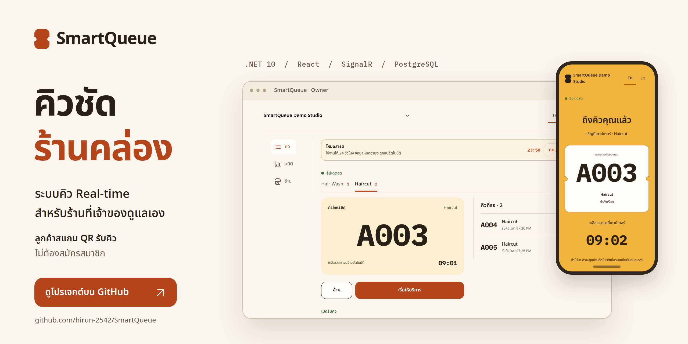

---

## สารบัญ

- [ภาพรวม](#ภาพรวม)
- [ฟีเจอร์](#ฟีเจอร์)
- [หน้าจอ](#หน้าจอ)
- [สถาปัตยกรรม](#สถาปัตยกรรม)
- [เริ่มใช้งาน](#เริ่มใช้งาน)
- [โหมด Demo](#โหมด-demo)
- [การพัฒนา](#การพัฒนา)
- [การทดสอบ](#การทดสอบ)
- [โครงสร้างโปรเจกต์](#โครงสร้างโปรเจกต์)
- [เอกสาร](#เอกสาร)
- [ข้อจำกัดและหมายเหตุ](#ข้อจำกัดและหมายเหตุ)

---

## ภาพรวม

ร้านตัดผม คลินิก ร้านซ่อม และร้านล้างรถที่มีเจ้าของคนเดียวต้องให้บริการไปพร้อมกับจัดการคิว ลูกค้าไม่รู้ว่าอีกนานแค่ไหน เจ้าของต้องละมือจากงานมาดูว่าใครรออยู่ SmartQueue แทนที่การเรียกด้วยเสียงและกระดาษจดคิวด้วยระบบเดียว:

| บทบาท | อุปกรณ์ | สิ่งที่ทำได้ |
|---|---|---|
| **ลูกค้า** | มือถือ (สแกน QR) | เลือก Service, รับ Ticket โดยไม่สมัคร, เห็นจำนวนคิวก่อนหน้าและเวลารอโดยประมาณ, ได้รับแจ้งเตือนเมื่อใกล้ถึงคิว, ยกเลิกคิวของตัวเอง |
| **เจ้าของร้าน** | มือถือ หรือ คอมพิวเตอร์ | เปิด/ปิดคิว, เรียกคิวและเริ่มให้บริการ, ออก Walk-in Ticket, จัดการร้าน/บริการ, ดาวน์โหลด QR, อ่านสถิติและ demand |
| **จอหน้าร้าน** | จอหรือแท็บเล็ตแนวนอน | แสดงคิวที่กำลังเรียก, คิวที่เรียกไปแล้ว และคิวถัดไปแยกตาม Service โดยไม่ต้อง login |
| **ผู้ชม (Demo)** | เบราว์เซอร์ | กดปุ่มเดียวเข้าเป็นเจ้าของร้านตัวอย่าง มีข้อมูลย้อนหลังและจำลองลูกค้าผ่าน API จริง |

จุดที่ออกแบบมาเพื่องานจริง:

- **เลขคิวผูกกับ Business day ไม่ใช่วันตามปฏิทิน** — เปิดคิวรอบใหม่แล้วนับ 1 ใหม่ เที่ยงคืนไม่รีเซ็ตเอง (ดู [`docs/adr/0002-business-day-replaces-calendar-day.md`](docs/adr/0002-business-day-replaces-calendar-day.md))
- **Ticket link คือตัวตนของลูกค้า** — ไม่มีบัญชี ไม่มีเบอร์โทร เปลี่ยนเครื่องหรือล้าง browser data แล้วยังตามคิวเดิมได้ (ดู [`docs/adr/0001-customer-identity-is-the-ticket-link.md`](docs/adr/0001-customer-identity-is-the-ticket-link.md))
- **กดซ้ำหรือกดพร้อมกันไม่ทำให้คิวพัง** — ทุก transition ตัดสินด้วย PostgreSQL ตามลำดับ commit แรกชนะ (ดู [`docs/adr/0003-ticket-transitions-via-postgres-first-committed-wins.md`](docs/adr/0003-ticket-transitions-via-postgres-first-committed-wins.md))
- **เจ้าของถือคิวได้ทีละใบต่อร้าน** — partial unique index บังคับให้มี Called/InService ได้ไม่เกินหนึ่งใบพร้อมกันทั้ง Shop

---

## ฟีเจอร์

### ลูกค้า (มือถือ)
- เปิดจาก QR หรือลิงก์ร้าน เห็น Service ที่เปิดรับคิว จำนวนคิวก่อนหน้า และเวลารอโดยประมาณทันที
- รับ Ticket โดยไม่ต้องสมัคร ไม่ต้องกรอกเบอร์; ใส่ชื่อเล่น/หมายเหตุได้ถ้าต้องการ (เจ้าของร้านเห็นเท่านั้น)
- หน้า Ticket แสดง **จำนวนคิวก่อนหน้า** เป็นตัวเลขหลัก, สถานะ Waiting → Called → InService → จบ, และนาฬิกานับถอยหลังเมื่อถูกเรียก
- Web Push เมื่อใกล้ถึงคิวหรือถูกเรียก พร้อมปุ่มคัดลอกลิงก์คิวเพื่อเปิดบนเครื่องอื่น
- ยกเลิกคิวเองได้ขณะ Waiting หรือ Called; สถานะสุดท้ายยังเปิดดูได้ 24 ชั่วโมงหลังคิวสิ้นสุด
- หน้าร้านสาธารณะไม่แสดงหมายเหตุส่วนตัวและไม่แสดงข้อมูลเจ้าของ

### เจ้าของร้าน
- **คิว**: เลือก Service ด้วยแท็บ, เรียกคิวถัดไป (FIFO โดยเซิร์ฟเวอร์เลือกให้), เริ่มให้บริการ, เสร็จสิ้น, ข้าม, และออก Walk-in Ticket ให้ลูกค้าที่ไม่มีมือถือ
- **ปิดรับคิว / ปิดทันที**: Closing ยังเรียกคิวที่ค้างอยู่ได้จนหมด; Drop ยุติเฉพาะคิวที่ Waiting และนับแยกจาก Cancel/Skip
- **ร้าน**: สร้าง/แก้ไขร้านและบริการ (ชื่อ, Prefix, Call timeout, Near-turn threshold), ดาวน์โหลด QR เป็น PNG, คัดลอกลิงก์รับคิว, เก็บบริการแบบ archive โดยไม่ลบประวัติ
- **สถิติ**: จำนวนที่ออกให้บริการ ระยะเวลารอ/ให้บริการ อัตราตามผลลัพธ์ แยกตาม Business day และ Service พร้อมชั่วโมงคนเยอะตามเวลา Asia/Bangkok
- ใช้ได้ทั้งมือถือและคอมพิวเตอร์: ตั้งแต่ 1024px เปลี่ยนแท็บล่างเป็นแถบเมนูด้านข้าง และแสดงคิวปัจจุบันคู่กับคิวที่รอ

### จอหน้าร้าน (Display board)
- หน้า `/board/{publicId}` อ่านอย่างเดียว ธีมเข้มสำหรับจอที่มองจากระยะไกล: คิวที่กำลังเรียก, รายการที่เรียกไปแล้ว, คิวถัดไปแยกตาม Service
- ไม่มีหมายเหตุลูกค้า ไม่มี bearer link และไม่ต้อง login; ตัวเลขคิวใช้ฟอนต์ mono ที่แยก `0` กับ `O` ชัด

### Live และ Notification
- SignalR hub เดียว (`/live`) แยก group ตามผู้รับ: เจ้าของเห็นทั้งร้าน, ลูกค้าเห็นเฉพาะ Ticket ของตน, จอหน้าร้านเห็นภาพสาธารณะ
- เน็ตหลุดแล้วกลับมาเชื่อมเอง; ขณะไม่ live ข้อมูลถูกทำเครื่องหมายว่าอาจเก่าและคำสั่งเสี่ยงถูกปิด
- Worker ฝั่งเซิร์ฟเวอร์ตรวจ Call timeout ทุก 5 วินาที รวมถึงหลังรีสตาร์ท จึง Skip ให้เองได้แม้ไม่มีใครเปิดหน้าจอ

---

## หน้าจอ

ภาพทั้งหมดถ่ายจากระบบที่รันจริงบนเครื่องนี้ (Production build + Demo Mode) ไม่ใช่ mockup — ต้นแบบ SVG อยู่ใน [`docs/design/`](docs/design)

### ลูกค้า — สแกน QR แล้วรับคิวจากมือถือ

| เลือก Service | รับคิว | รอเรียก |
|---|---|---|
| 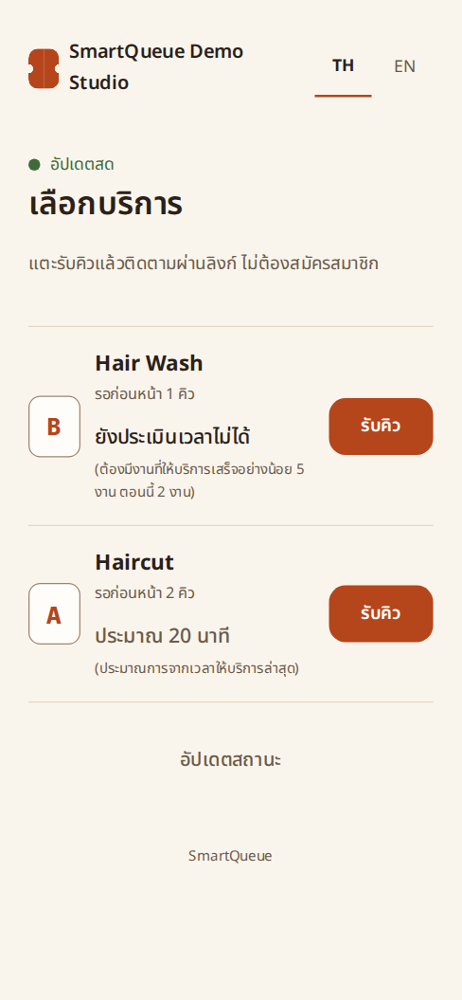 | 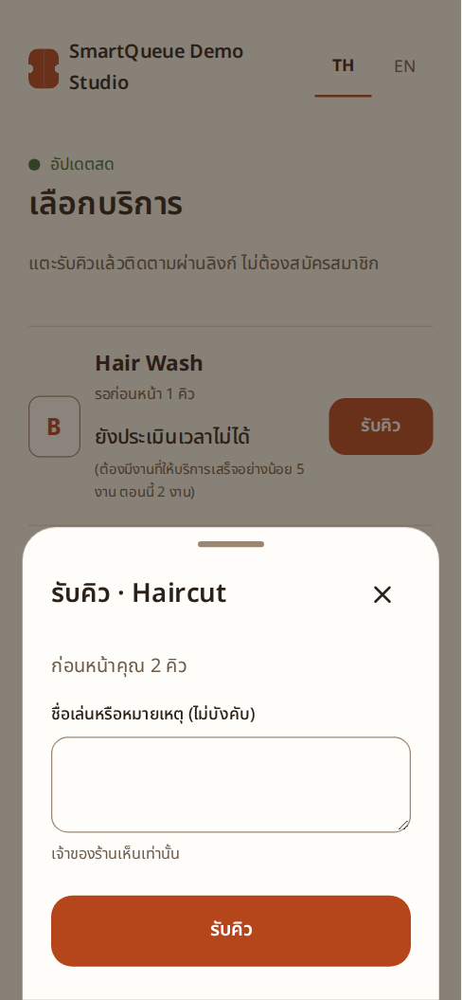 | 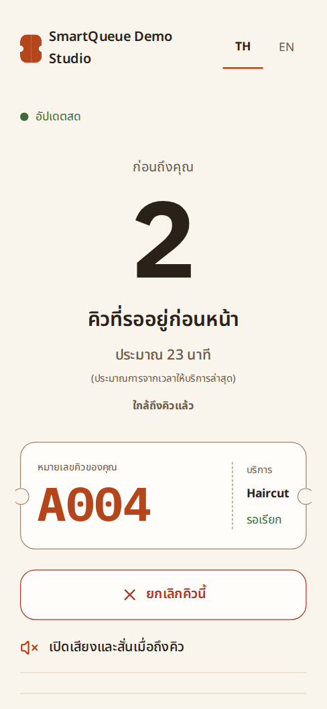 |

| ถึงคิวคุณแล้ว | เสร็จสิ้น |
|---|---|
| 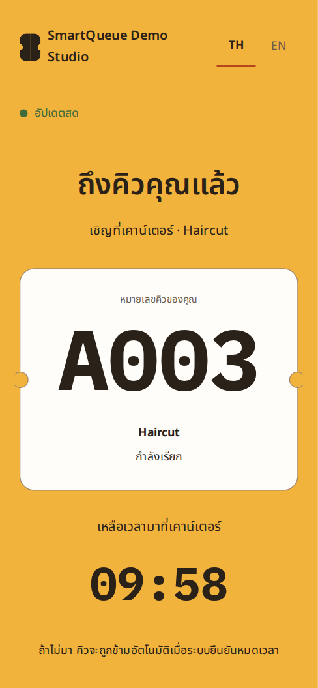 | 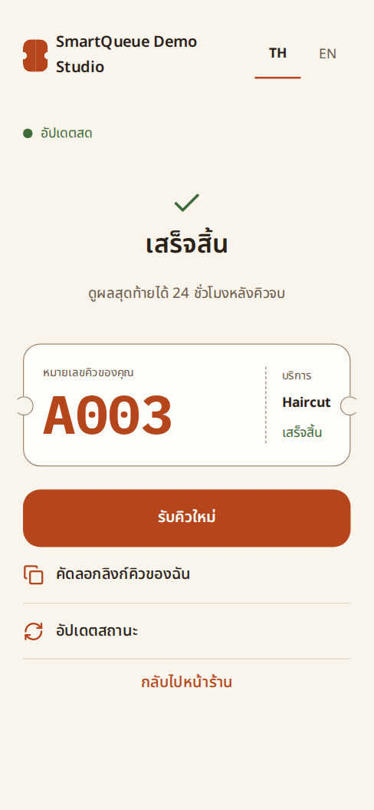 |

### เจ้าของร้าน — คิวปัจจุบันและคิวที่รอพร้อมกันบนคอมพิวเตอร์

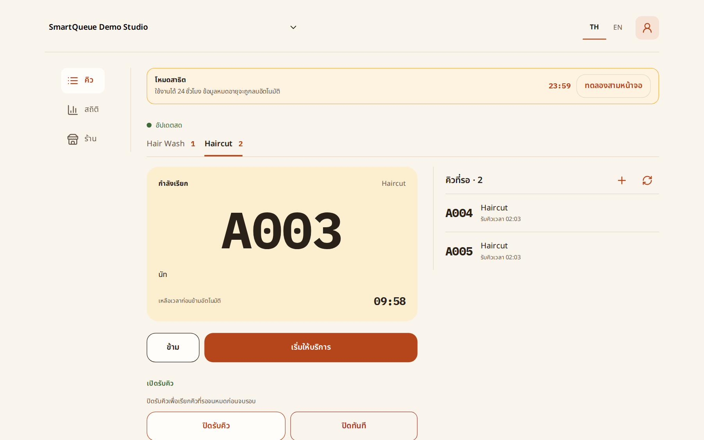

| ระหว่างให้บริการ | ร้านและ QR | สถิติและ demand |
|---|---|---|
| 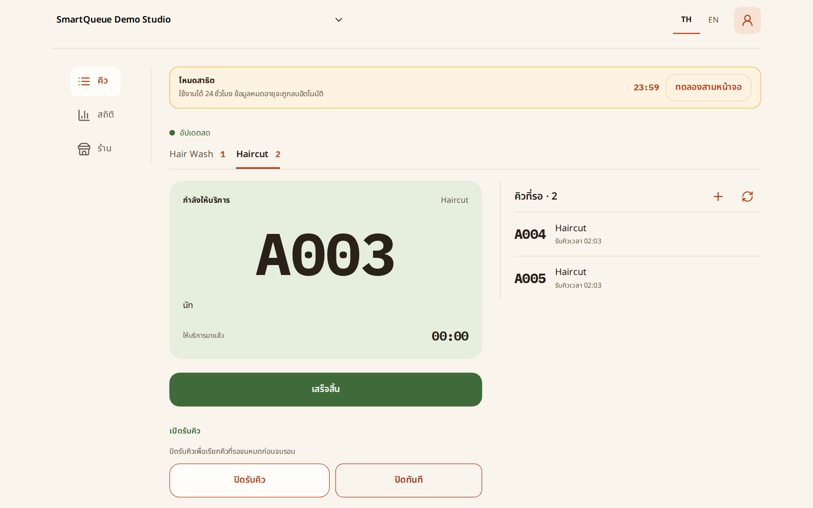 | 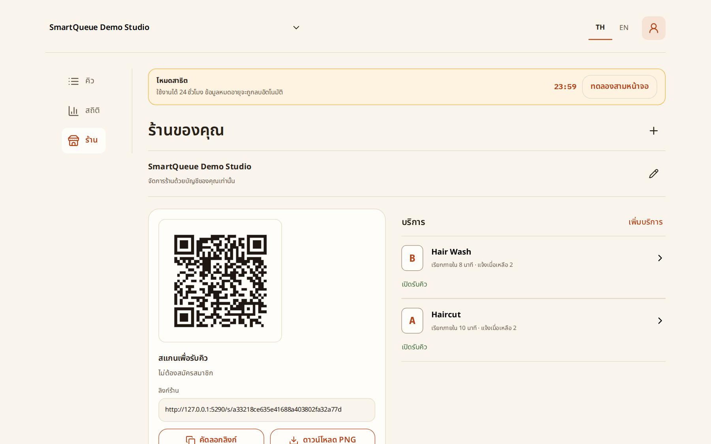 | 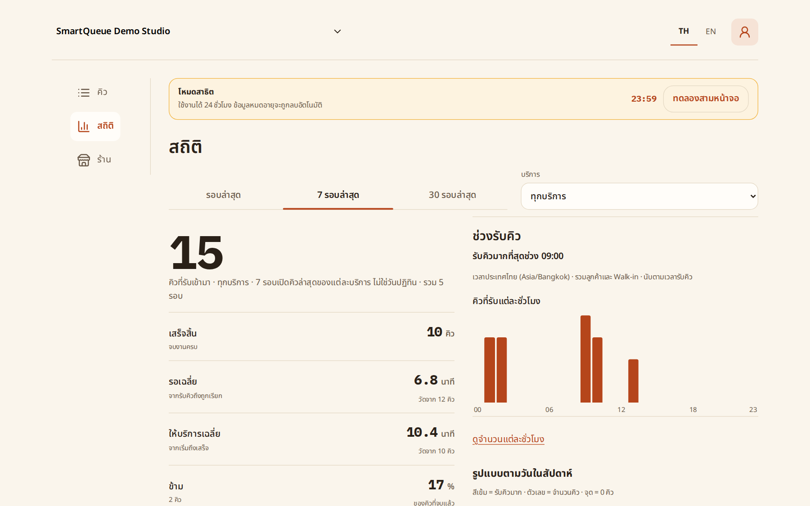 |

### คิวบนมือถือ และจอหน้าร้าน

| คิวบนมือถือ | จอหน้าร้าน |
|---|---|
| 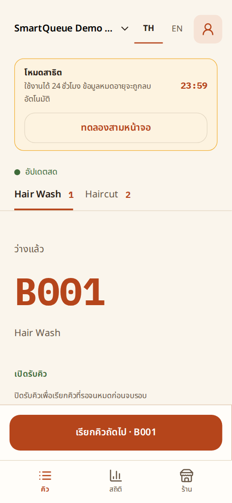 | 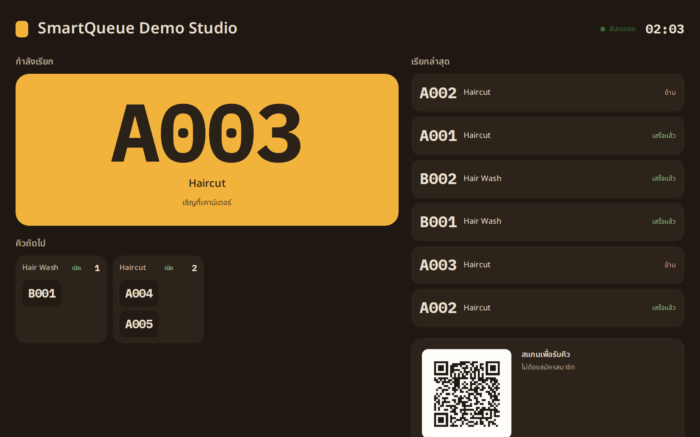 |

### Demo Mode

| เข้าสู่ระบบ (มีปุ่มเข้าโหมดสาธิต) | จำลองลูกค้า |
|---|---|
| 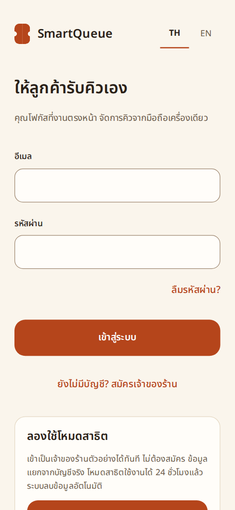 | 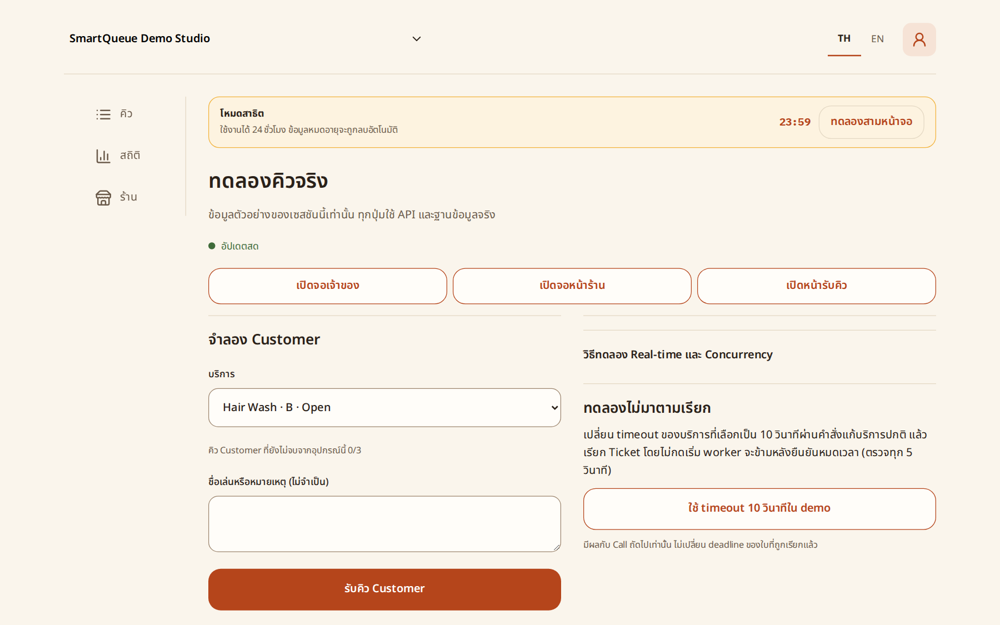 |

---

## สถาปัตยกรรม

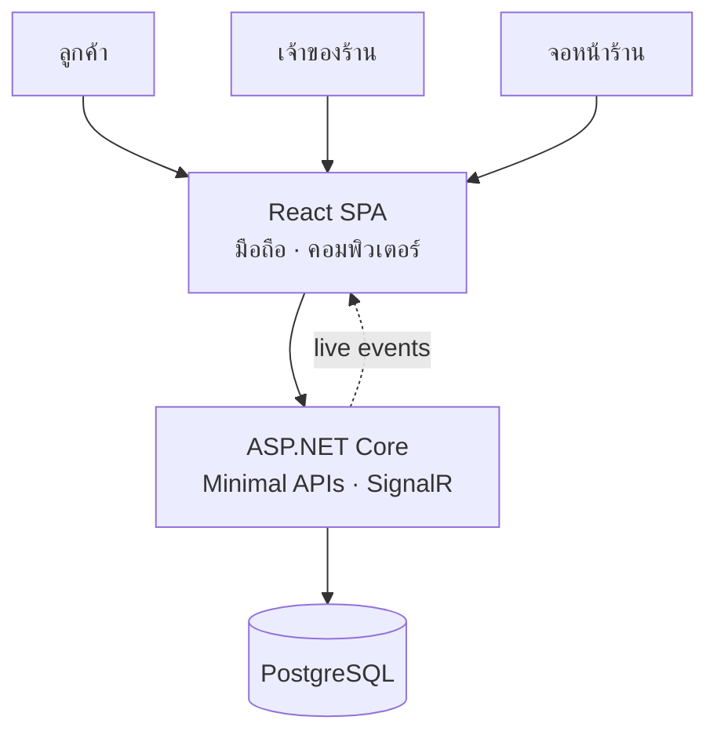

- **Single origin**: SPA และ API เสิร์ฟจาก origin เดียวกัน (production: `server/wwwroot`; development: Vite proxy `/api` และ `/live`) cookie session และ WebSocket จึงไม่ต้องมี CORS
- **Backend**: ASP.NET Core Minimal APIs แยกตามฟีเจอร์ (`Tickets`, `Serving`, `Shops`, `Board`, `Statistics`, `Live`, `Push`, `Demo`, `Identity`) — โปรเจกต์เดียว ไม่มี MediatR
- **Realtime**: SignalR hub เดียว (`/live`) และ fan-out ข้ามอินสแตนซ์ผ่าน PostgreSQL commit notification
- **Database**: EF Core + Npgsql, migrations apply เองตอน API สตาร์ท, เลขคิวออกภายใต้ row lock ของ Shop, snapshot หลาย query อ่านใน repeatable-read
- **Push**: VAPID + `Lib.Net.Http.WebPush`, ส่งหลัง commit แบบ best effort; payload มีแค่ Ticket ID, event, เลขคิว และภาษา — ลิงก์ส่วนตัวอยู่ใน IndexedDB ของเครื่องที่ opt-in

| ชั้น | เทคโนโลยี |
|---|---|
| Frontend | React 19.3 · TypeScript 7 · Vite 8 · React Router 7 · `@microsoft/signalr` · Noto Sans Thai + IBM Plex Mono |
| Backend | ASP.NET Core 10 (Minimal APIs) · ASP.NET Identity (cookie) · SignalR · EF Core 10 |
| Database | PostgreSQL 16 |
| Push | Web Push / VAPID (`Lib.Net.Http.WebPush`) |
| Tests | `node --test` (HTTP จริง) · xUnit + PostgreSQL จริง · Playwright (มือถือ 375×812 และเดสก์ท็อป 1280×900) |

---

## เริ่มใช้งาน

ต้องมี **.NET 10 SDK**, **Node 24** และ **Docker**

```bash
docker compose up -d --wait
npm ci
npm --prefix web ci
dotnet restore server/SmartQueue.Api.csproj --locked-mode
dotnet tool restore
```

เริ่ม API ( migrations apply อัตโนมัติ):

```bash
ASPNETCORE_ENVIRONMENT=Development dotnet run --project server/SmartQueue.Api.csproj --no-launch-profile --urls http://127.0.0.1:5290
```

เริ่ม web อีก terminal:

```bash
npm run dev
```

แล้วเปิด **<http://127.0.0.1:5179>**

| บริการ | ที่อยู่ |
|---|---|
| Web (Vite) | <http://127.0.0.1:5179> |
| API | <http://127.0.0.1:5290> — ตรวจที่ `/api/health` ต้องได้ `{"status":"ready"}` |
| PostgreSQL | loopback `5449` |
| SMTP / Mailpit | `1026` / <http://127.0.0.1:8026> |

> ตอนพัฒนาให้เปิดผ่าน Vite `:5179` เพราะ `PublicOrigin` ใน `appsettings.Development.json` ชี้ที่พอร์ตนั้น ลิงก์ในอีเมลยืนยัน/กู้รหัสผ่านจึงกลับเข้า dev server ได้ (เปิด `:5290` ตรง ๆ ก็ใช้แอปได้ แต่ลิงก์ในอีเมลจะพาไป `:5179`)
>
> `127.0.0.1` ใช้ได้เฉพาะเครื่องที่รัน ถ้าจะสแกน QR ด้วยมือถือจริงให้รัน SPA+API บน IP ในวง LAN แล้วตั้ง `PublicOrigin` ให้ตรง

หยุดระบบ: `docker compose down` — ล้างข้อมูลทั้งหมด: `docker compose down -v`

### ตัวแปรที่ต้องตั้งก่อนขึ้น production

| ตัวแปร | ความหมาย |
|---|---|
| `ConnectionStrings__Database` | PostgreSQL connection string |
| `PublicOrigin` | origin จริงที่ใช้สร้างลิงก์ในอีเมล (ต้องเป็น HTTPS) |
| `Smtp__Host` / `Smtp__Port` / `Smtp__From` / `Smtp__UseTls` | การส่งอีเมลยืนยันและกู้รหัสผ่าน |
| `DataProtection__KeyPath` | ที่เก็บคีย์ถาวรที่ทุกอินสแตนซ์ใช้ร่วมกัน |
| `Push__PublicKey` / `Push__PrivateKey` / `Push__Subject` | VAPID identity (ต้องคงเดิมข้ามการ deploy) |
| `SMARTQUEUE_DB_PASSWORD` | รหัสฐานข้อมูลของ compose (ค่าเริ่มต้นเป็น local-only) |

Production SPA ถูก build ลง web root ของ API ด้วย `npm --prefix web run build` — ไม่ต้องมี web server แยก

---

## โหมด Demo

เข้าที่หน้าแรกแล้วกด **เข้าโหมดสาธิต** — ได้เป็นเจ้าของร้านตัวอย่างโดยไม่ต้องสมัคร ข้อมูลแยกจากบัญชีจริงและหมดอายุใน 24 ชั่วโมง (ปุ่มนี้อยู่ใต้ฟอร์มเข้าสู่ระบบในภาพ[หน้าจอ](#หน้าจอ))

Demo seed สร้างร้าน "SmartQueue Demo Studio" ที่มี 2 บริการ (Haircut `A`, Hair Wash `B`), ประวัติ 5 Business day ที่มี Completed จริง 8 ใบ + Skipped 1 ใบ เพื่อให้ estimated wait และสถิติทำงานได้ทันที และมี Waiting Ticket ค้างไว้ให้เรียก

กด **ทดลองสามหน้าจอ** เพื่อเปิด Owner, Customer และ Display board พร้อมกันในแท็บแยก — การจำลองลูกค้าออก Ticket ผ่าน endpoint เดียวกับหน้าร้านจริง (intent replay, extra-Ticket confirmation และ device quota ทำงานเหมือนของจริง) ปุ่ม "ใช้ timeout 10 วินาทีใน demo" แก้ Service ผ่านคำสั่งปกติ เพื่อให้เห็น auto-Skip ของ worker จริง

ทุกหน้าจอที่แสดงข้อมูลตัวอย่างจะมีป้าย `โหมดสาธิต` กำกับ ข้อมูลทั้งหมดเป็นข้อมูลสังเคราะห์

---

## การพัฒนา

```bash
npm run dev                 # Vite ที่ :5179 (proxy /api และ /live ไป :5290)
npm run api                 # API ที่ :5290
npm run build               # build SPA ลง server/wwwroot แล้ว build API
```

### Migration

```bash
dotnet ef migrations add <Name> --project server/SmartQueue.Api.csproj --output-dir Migrations
```

Migration apply อัตโนมัติเมื่อ API สตาร์ท — อย่าลบ volume ของฐานข้อมูลเพื่อ "อัปเดต" แอป

### หน้าจอเพิ่มเติม

- `/resume` — จุดเริ่มของ PWA ที่ติดตั้งบน Home Screen: เปิด Ticket ล่าสุด, วางลิงก์เดิม หรือเข้าโหมดเจ้าของ
- `/s/{publicId}` — หน้ารับคิวสาธารณะของร้าน
- `/t/{secret}` — หน้า Ticket ส่วนตัวของลูกค้า
- `/board/{publicId}` — จอหน้าร้าน

---

## การทดสอบ

```bash
# seam 1 — HTTP + PostgreSQL + Mailpit จริง (ต้องรัน docker compose และ API)
npm test

# seam 2 — .NET integration suite, สร้างฐานข้อมูลแยกต่อเทสต์
dotnet test tests/SmartQueue.IntegrationTests/SmartQueue.IntegrationTests.csproj

# seam 3 — Playwright บน host ที่แยกฐานข้อมูลของตัวเอง
npx playwright install chromium
npm run test:e2e
npm run test:e2e:report
```

ทั้งสามชุดใช้ของจริงทั้งหมด: HTTP session จริง, PostgreSQL จริง, ข้อความอีเมลที่ส่งถึง Mailpit จริง และ SignalR จริง ไม่มี mock API response และไม่มี hard sleep บัญชีฐานข้อมูลที่ใช้ทดสอบต้องมีสิทธิ์ `CREATE DATABASE` เพราะ suite สร้างและลบฐานข้อมูลของตัวเอง (`SMARTQUEUE_TEST_CONNECTION` หรือ `SMARTQUEUE_TEST_DB_*` ใช้ชี้ไปที่อื่นได้)

Playwright มี project `mobile-chromium` (375×812, touch) และ `desktop-chromium` (1280×900) — runner build production bundle แล้วเปิดแอปจริงบน loopback `5310` แต่ละรอบสร้างฐานข้อมูลใหม่ผ่าน test host, ใช้เวลาจริงและ SMTP จริง และลบฐานข้อมูลเมื่อปิดอย่างสุภาพ (มี guard ตรวจชื่อฐานข้อมูลก่อนลบ) คีย์ DataProtection/VAPID ใช้โฟลเดอร์ชั่วคราวแยกต่อรอบ ไม่แตะ key ring หรือฐานข้อมูลพัฒนาของผู้พัฒนา

สิ่งที่ชุด E2E ครอบคลุม:

- สมัคร → ยืนยันอีเมลจริง → เข้าสู่ระบบ, ปฏิเสธบัญชีที่ยังไม่ยืนยัน, กู้รหัสผ่าน, การแยกข้อมูลระหว่างเจ้าของ
- รับ Ticket แบบไม่สมัคร, FIFO ผสม Customer/Walk-in, ยืนยัน extra-Ticket ตามโควตา, Call/Start/Complete/Cancel/Skip, Stop/Drop/Archive
- Call พร้อมกันสองเครื่อง, auto-Skip จาก worker จริง, สามหน้าจอ demo, offline แล้ว resync
- QR PNG ที่ดาวน์โหลดจริงถูกถอดรหัสด้วยตัวอ่านอิสระ แล้วตามต่อจนถึงการเรียกคิวจริง
- สถิติ/อัตรา/Business day แยกกัน, ตัวกรอง Service, demand ตามชั่วโมงที่รับคิวจริง
- Responsive 320/375px, breakpoint คอมพิวเตอร์, แนวตั้ง 844×390, reduced motion, คีย์บอร์ด, ข้อความ 200%

ผลล่าสุดบนเครื่องนี้: `npm test` **57/57**, `dotnet test` **30/30**, Playwright **60/60**, `npm run build` 0 warning / 0 error

ผลที่ล้มเหลวจะเก็บ screenshot, video และ trace ไว้ใน `test-results/e2e/`; report อยู่ที่ `playwright-report/` — artifact เหล่านี้มีลิงก์ Ticket ส่วนตัว ห้าม publish

---

## โครงสร้างโปรเจกต์

```
server/                       ASP.NET Core — Minimal APIs + SignalR
  Domain/ Data/ Migrations/   entity, DbContext, migration
  Tickets/ Serving/ Shops/    รับคิว, เรียก/เริ่ม/เสร็จ/ข้าม, ปิดคิว, Walk-in, QR
  Board/ Statistics/ Push/    จอหน้าร้าน, สถิติและ demand, Web Push
  Live/ Identity/ Demo/       SignalR hub, บัญชีเจ้าของ, โหมดสาธิต
  wwwroot/                    SPA ที่ build แล้ว (ไม่ commit)
web/                          React SPA
  src/*.tsx                   หน้าจอ: คิว, ร้าน, สถิติ, Ticket, จอหน้าร้าน, demo
  src/useLive.ts              SignalR + resync/offline guard
  src/styles.css              design tokens และ desktop/container-query layout
  public/                     manifest, service worker, ไอคอน
tests/
  *.test.mjs                  seam 1 — HTTP/PostgreSQL/Mailpit จริง
  SmartQueue.IntegrationTests/ seam 2 — xUnit + PostgreSQL
  SmartQueue.E2eHost/         host สำหรับ Playwright (ฐานข้อมูลแยกต่อรอบ)
  e2e/*.spec.mjs              seam 3 — Playwright mobile + desktop
docs/
  adr/                        บันทึกการตัดสินใจเชิงสถาปัตยกรรม
  design/                     DESIGN.md (Warm Minimal) + ต้นแบบ SVG 18 หน้าจอ
  screenshots/                ภาพจากระบบจริง (ใช้ใน README นี้)
  promo/                      ภาพโปรโมทและไฟล์ต้นทาง
.scratch/smartqueue/          spec.md + ticket 01–17 พร้อมหลักฐานการตรวจรับ
CONTEXT.md                    คำในโดเมน (Shop, Service, Queue, Business day, …)
```

---

## เอกสาร

| ไฟล์ | เนื้อหา |
|---|---|
| [`.scratch/smartqueue/spec.md`](.scratch/smartqueue/spec.md) | ข้อกำหนดเชิงพฤติกรรม (problem, solution, 70 user stories, testing decisions) |
| [`.scratch/smartqueue/issues/`](.scratch/smartqueue/issues) | ticket 01–17 พร้อมหลักฐานการตรวจรับ |
| [`CONTEXT.md`](CONTEXT.md) | คำในโดเมนและคำที่ควรเลี่ยง |
| [`docs/design/DESIGN.md`](docs/design/DESIGN.md) | design system: tokens, type, motion, accessibility, desktop adaptation |
| [`docs/design/`](docs/design) | ต้นแบบ SVG รายหน้าจอ (C = ลูกค้า, O = เจ้าของ, B = จอหน้าร้าน) |
| [`docs/adr/`](docs/adr) | ADR: Ticket link คือตัวตน, Business day, commit-first transitions |
| [`docs/agents/`](docs/agents) | กติกาสำหรับ agent: domain, issue tracker, triage labels |

---

## ข้อจำกัดและหมายเหตุ

- **ข้อมูลทั้งหมดเป็นข้อมูลสังเคราะห์** — ร้าน "SmartQueue Demo Studio", บริการ Haircut/Hair Wash และเลขคิวทั้งหมดไม่มีอยู่จริง
- **ขอบเขตคือเจ้าของคนเดียวต่อร้าน** — ไม่มี Staff, Branch, หลายสาขา หรือ presence ของเจ้าของ; แต่ละ Shop ถือ Called/InService ได้หนึ่งใบ
- **ไม่มีเบอร์โทรหรือ LINE** — ช่องแจ้งเตือนเดียวคือ Web Push ที่ลูกค้าต้อง opt-in และ iPhone/iPad ต้องติดตั้งลง Home Screen ก่อน
- **ตรวจบน Chromium** — responsive และ QR ทดสอบด้วย viewport emulation บน Chromium; ยังไม่ได้ทดสอบบน iPhone/Safari หรือ Windows เครื่องจริง และยังไม่ได้ยืนยันการส่ง Push ผ่าน FCM ถึงอุปกรณ์ iOS จริง
- **โควตาต่ออุปกรณ์เป็น best-effort** — ลิมิต 3 Ticket ต่อ Queue ต่ออุปกรณ์อิง cookie; ล้าง browser data แล้วข้ามได้ ซึ่งยอมรับได้เพราะเจ้าของ Skip no-show ได้
- ระบบออกแบบให้รันในเครื่อง — ก่อนขึ้น production จริงต้องตั้ง HTTPS, `PublicOrigin`, คีย์ DataProtection ถาวร, VAPID ของตัวเอง และปิด demo ถ้าไม่ต้องการให้ใครเข้า
- repo นี้ไม่มีไฟล์ `LICENSE` — สงวนลิขสิทธิ์โดยผู้เขียน ใช้เป็นผลงานอ้างอิง/พอร์ตโฟลิโอ
